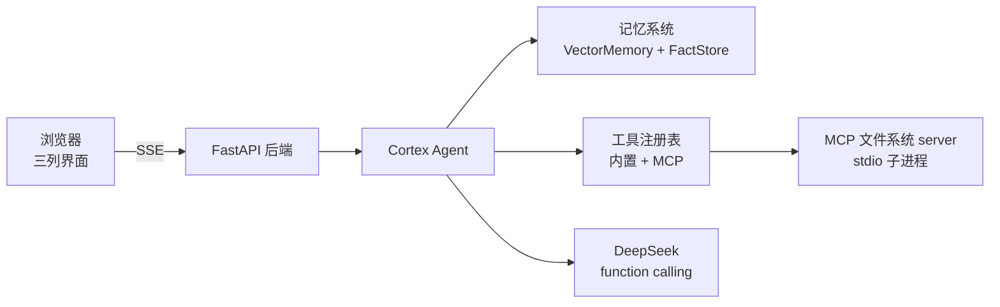

# Cortex · 透明 AI 助手

一个**可观察**的 AI Agent：把「记忆」「工具调用」「MCP」「前后端」串成一个完整项目。它的独特之处不是"能聊天"，而是**你能看到 Agent 每一步在做什么**——回忆了什么记忆、调了什么工具、怎么固化成事实，而不是只有一个冷冰冰的回答。

灵感来自 [picoagents](https://github.com/borhen68/picoagents) 的 dual-memory + tool 设计，核心循环手写；LLM 层通过 LangChain 的 `ChatDeepSeek`（`langchain-deepseek`）接入 DeepSeek。

## 核心能力

| 能力 | 实现 | 位置 |
|------|------|------|
| **短期记忆** | 按 `session_id` 缓存近期对话历史，注入上下文，保留最近 N 轮 | `agent/agent.py` |
| **长期记忆** | `VectorMemory`（余弦相似度 × 指数时间衰减）+ `FactStore`（三元组冲突合并）+ LLM 固化 | `agent/memory/` |
| **工具** | `@tool` 装饰器 + 手写 JSON Schema 校验 + 失败自动重试 + 结果缓存 + 沙箱 | `agent/tools/` |
| **MCP** | 用 `mcp` SDK 写文件系统 server，Agent 通过 MCP 协议调用它 | `agent/mcp/` |
| **透明/流式** | Agent 每一步产出一个事件，最终回答逐 token 流式，SSE 实时推给前端 | `agent/events.py` |

## 架构



一次对话的完整链路（每个环节都是前端可见的事件）：

```
用户消息
  ├─ 1. 检索长期记忆（余弦 × 时间衰减）      → memory_recalled
  ├─ 2. 注入 system prompt + 本会话短期记忆（历史对话）
  ├─ 3. ReAct 循环：调工具 → 拿结果 → 再决定 → tool_called / tool_result
  ├─ 4. 得到最终回答                          → final_answer
  ├─ 5. 记录短期记忆（最近 N 轮）
  └─ 6. 固化长期记忆：提取事实 + 摘要         → fact_extracted
```

## 目录结构

```
cortex/
├── agent/                 # Agent 核心（纯 Python，可独立用）
│   ├── agent.py           # 核心 Agent：记忆+工具+MCP 串成事件流
│   ├── events.py          # 结构化事件（透明展示）
│   ├── llm.py             # DeepSeek 客户端（LangChain ChatDeepSeek，chat + function calling）
│   ├── memory/            # 记忆子系统（向量/事实/固化）
│   ├── tools/             # 工具子系统（协议/校验/注册表/沙箱/内置工具）
│   └── mcp/               # MCP 客户端 + 文件系统 server
├── backend/               # FastAPI + SSE 后端 + 前端静态页
│   ├── main.py
│   └── static/index.html  # 原生 HTML/CSS/JS 三列界面
├── cli.py                 # 交互式命令行演示
├── demo.py                # 离线演示（不联网也能跑完整链路）
├── migrate_memory.py      # 一次性迁移脚本（JSON 记忆 → chromadb / 重算旧向量）
├── tests/                 # 单元测试（脚本化 LLM，不花钱）
├── deploy/
│   └── Caddyfile          # 反向代理 + HTTP Basic 鉴权（不含凭据，从环境变量读）
├── Dockerfile             # 生产镜像（python:3.12-slim）
├── docker-compose.yml     # cortex + caddy 两个服务
├── DEPLOY.md              # 部署到云服务器的完整步骤
├── requirements.txt       # 核心依赖（不含 chromadb）
├── requirements-chroma.txt# 可选：chromadb 向量后端
└── .env.example
```

## 向量后端：JSON（默认）或 chromadb

向量记忆有两套实现，对外接口完全一致，在**装配点**按环境变量选：

| 后端 | 特点 | 数据落盘 |
|---|---|---|
| `VectorMemory`（默认） | 纯 numpy 全量扫描 + JSON 全量覆写，**零额外依赖** | `.cortex/vector_memory.json` |
| `ChromaVectorMemory` | chromadb 持久化 + HNSW 近似最近邻，**写入即落盘**，不用全量重写 | `.cortex/chroma/` |

```bash
# 装 chromadb（约 30 个传递依赖，含 onnxruntime / grpcio / kubernetes）
.venv\Scripts\python.exe -m pip install -r requirements-chroma.txt

# 一键切换
set CORTEX_MEMORY_STORE=chroma     # Windows cmd
export CORTEX_MEMORY_STORE=chroma  # bash
```

要点：

- 不设 `CORTEX_MEMORY_STORE` 时是 JSON 后端，**chromadb 完全不会被 import**（惰性导入），所以不装也照跑。
- 设了 `chroma` 但 chromadb 装不上（或目录打不开）会**降级回 JSON 并打一行警告**，不会让启动崩掉。
- 两种后端的 `save()`/`load()` 签名一致：JSON 后端写文件，chroma 后端是 no-op（它自己持久化），
  所以 `MemoryEngine.save()` 的调用点一行都不用改，`facts.json` 照旧写 JSON。
- 后端与 CLI 各用各的目录（`.cortex/` vs `.cortex-cli/`），chroma 落在各自的 `chroma/` 子目录里，
  避免两个进程抢同一个 sqlite。
- chromadb 的 `PersistentClient` 同一目录同一时刻只允许一个进程打开，所以后端仍然**只能单 worker**。

### 迁移已有记忆

```bash
python migrate_memory.py --dry-run        # 先看会写什么，不落盘
python migrate_memory.py                  # .cortex/vector_memory.json → .cortex/chroma
python migrate_memory.py --rewrite-json   # 只重算 JSON 里的向量（不切 chroma 时用）
```

脚本从 `text` **重算**向量而不是沿用文件里存的（原因见下），id 由 `(text, created_at)`
确定性派生 + chroma `upsert`，所以可以反复执行而不产生重复行。

## 快速开始

```bash
cd E:\agent-project\cortex
pip install -r requirements.txt

# 1) 配置 DeepSeek key
copy .env.example .env        # 编辑 .env 填入 DEEPSEEK_API_KEY

# 2) 命令行演示
python cli.py

# 3) Web 演示（推荐）
run.bat                       # 一键：激活 .venv + 起服务 + 延迟开浏览器；可带端口 run.bat 8001

# 等价于手动跑：
python -m uvicorn backend.main:app --host 127.0.0.1 --port 8000
# 浏览器打开 http://127.0.0.1:8000/static/index.html（根路径 / 会 307 跳到这里）
```

> `run.bat` 在**前台**跑 uvicorn，Ctrl+C 才会触发 lifespan 收尾（落盘记忆 + 关 MCP 子进程）；直接关窗口会跳过这一步。

没有 API key 也能体验——跑离线演示：

```bash
python demo.py
```

## 跑测试

```bash
python -m pytest -v
```

测试用脚本化的 `ScriptedLLM` 模拟多轮 function calling，**不联网、不花钱**，覆盖：记忆召回、工具调用、参数失败兜底、固化提取事实、MCP 客户端、沙箱安全边界。

> 必须用 `python -m pytest`，裸 `pytest` 会 `ModuleNotFoundError: agent`
>（项目里没有 `conftest.py` / `pyproject.toml`，裸跑时 pytest 不会把项目根放进 `sys.path`）。

## 部署到服务器

`Dockerfile` + `docker-compose.yml` + `deploy/Caddyfile`，两个容器、对外一个端口：

```
浏览器 ──► [caddy]  Basic 鉴权 + 反代 ──► [cortex]  端口不发布，公网连不到
                                            └── ./data  记忆落盘
```

完整步骤见 **[DEPLOY.md](DEPLOY.md)**，要点：

- 镜像是 `python:3.12-slim`（不是本地的 3.14）—— `chromadb` / `onnxruntime` 的原生
  wheel 在 Linux 上 3.12 齐全，3.14 很可能没有，pip 会退化成源码编译然后失败。
- 鉴权放在 **Caddy 而不是应用代码**里：以后加域名 + HTTPS 只需改 Caddyfile 几行，
  应用侧零改动。
- `CORTEX_MEMORY_STORE` 不设时 compose 默认给 `chroma`。

## 技术栈

- **LLM**：DeepSeek（`deepseek-flash`，即 DeepSeek-V4.1-Flash）经 LangChain `langchain-deepseek` 的 `ChatDeepSeek` 接入（原生 function calling）
- **后端**：FastAPI + uvicorn + SSE（Server-Sent Events）
- **前端**：原生 HTML / CSS / JS（CSS Grid 三列，无框架、无构建）
- **MCP**：`mcp` SDK（客户端 + 自写文件系统 server，stdio 传输）
- **向量检索**：numpy 手写（零向量库依赖，可插拔 `Embedder`）；可选 chromadb（HNSW + 持久化）
- **可观测/流式**：结构化事件流（`AgentEvent`）→ SSE → 前端实时渲染；最终回答逐 token 推送（`answer_delta`）

## 面试可讲的点

1. **记忆**：为什么用「余弦 × 时间衰减」而不是裸余弦——记忆随时间淡出；`FactStore` 用 subject+predicate 做冲突合并，实现"新事实覆盖旧事实"。
2. **可靠性**：裸调 function calling 会乱猜参数，这里用 JSON Schema 校验 + 错误回填让模型下一轮自动修正。
3. **安全边界**：让 LLM 调 shell 前拦了什么——命令白名单 + 危险片段黑名单 + 路径越界检查；`calculator` 用 `ast` 白名单运算符而非 `eval`。
4. **MCP 集成**：为什么走 MCP 而不是直接 import——工具可以跨语言、跨进程、标准化；这里 MCP 是 async 协议、主循环是同步的，讲清楚如何用「后台 event loop + 常驻协程」桥接。
5. **透明/可观测**：Agent 的每次决策都是事件，前端能看到完整推理链，这对调试和信任都很关键。
6. **短期 vs 长期记忆**：紧邻追问靠短期记忆（会话历史直接进上下文，精确、零成本），跨会话的偏好/事实靠长期记忆（固化后向量召回，有取舍地提炼）；两者各管一段，不能互相替代。
7. **一个自己找出来并修掉的 bug**：`HashEmbedder` 原本用内置 `hash()` 取哈希桶，而 CPython 对 `str` 的 `hash()` 会被 `PYTHONHASHSEED` 加盐——**跨进程不一致**。后果是「写盘那个进程存的向量」和「新进程算出的 query 向量」落在两个不相干的哈希空间里，余弦相似度退化成噪声，落盘的记忆再也检索不到（实测 40 条里 0 条自相似度超过 0.9）。改用 `zlib.crc32` 后跨进程恒定。**这类 bug 不会报错、不会崩，只会让检索"看起来在跑但结果全是随机的"**——所以加了跨进程的回归测试锁死算法。
8. **换向量库时怎么保住行为契约**：两套后端跑同一套断言（`tests/test_memory_backends.py`）。难点是 chroma 的 HNSW 只按距离排序，而这里的语义是「余弦 × 时间衰减」——直接取距离最近的 k 条会漏掉「余弦略低但更新」的记忆。解法是**扩容 + 剪枝**：未取回的项得分 ≤ 其余弦 ≤ 已取回里最差的余弦，所以只要第 k 名的得分不低于它就能安全停止，结果与全量重排可证明等价（最坏退化成全量扫描，不比 numpy 版更差）。
9. **部署前自己找出并修掉一个会泄露 API key 的漏洞**：`read_file` 的沙箱只校验「路径没越界」，
   而工作目录就是项目根，`.env` 正好在里面——公网部署后任何人对 Agent 说一句「读一下 .env」
   就能拿到 key。修法是补一层按文件名的敏感名单（`.env*` / `*.key` / `*.pem` / `id_rsa` …），
   按文件名而不是按目录匹配，所以「让 Agent 读自己的代码」的演示不受影响。
   注意这是**纵深防御的第二层**：第一层是 `.env` 根本不进镜像（`.dockerignore` + 密钥走
   环境变量注入），黑名单只是兜底。
10. **两个「看起来显然、实测不成立」的假设**——都是靠跑一遍才发现的：
    - MCP 的同名工具会**覆盖**内置工具（`ToolRegistry.register` 就是字典赋值）。所以线上跑的
      其实是 MCP 版的 `read_file`，内置那份的 `MAX_READ_BYTES` 是死代码。两个入口必须共用
      同一套沙箱函数，否则修了一个另一个还漏着。
    - 「父进程设了环境变量，子进程自然能继承」是错的：mcp SDK 给子进程的是
      `get_default_environment()`——一份**过滤过的白名单**，不是完整的 `os.environ`。
      所以在父进程里 `os.environ.setdefault("MCP_FS_ROOT", ...)` 完全无效，子进程里的沙箱根
      仍然回落到启动目录；必须通过 `StdioServerParameters(env=...)` 显式注入。
      两条都加了回归测试（`tests/test_sandbox.py`）。
